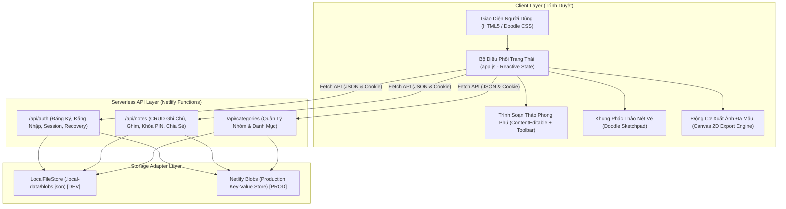

# ĐẶC TẢ KIẾN TRÚC HỆ THỐNG (SYSTEM ARCHITECTURE SPECIFICATION)
## DỰ ÁN: MẨU GHI CHÚ (ANIMATED NOTE)
> **Phiên bản kiến trúc:** 2.6.0  
> **Mục đích:** Kim chỉ nam định hướng cốt lõi cho thiết kế, bảo trì và phát triển tính năng trong toàn bộ vòng đời dự án.

---

## 1. TRIẾT LÝ THIẾT KẾ CỐT LÕI (CORE PHILOSOPHY)

Hệ thống **Mẩu Ghi Chú** được xây dựng dựa trên 4 trụ cột kiến trúc bất biến:

1. **Thủ công & Cảm xúc (Doodle Sketch Aesthetics):**
   - Loại bỏ hoàn toàn các thành phần đồ họa cứng nhắc, bóng bẩy kiểu AI nhân tạo.
   - Tôn vinh nét vẽ tay tự nhiên: đường viền mực *ink* lượn nhẹ, giấy sổ pastel (Vàng, Xanh, Hồng, Lục, Tím), vân ruột kẻ ngang/ô ly/chấm bi, băng dính washi tape, ghim cúc và tem thư hoài niệm.
   - Tạo cảm giác gần gũi, ấm áp như đang cầm một cuốn sổ tay thực thụ.

2. **Tiêu chuẩn Web thuần túy & Không phụ thuộc cồng kềnh (Zero-Bloat & Pure Web Standards):**
   - Không sử dụng các framework nặng (React, Vue, Angular, Next.js).
   - 100% xây dựng trên chuẩn Web hiện đại: **ES Modules**, **HTML5 `<dialog>`**, **CSS Custom Properties**, **Vanilla DOM Events**, và **HTML5 Canvas 2D API**.
   - Thời gian tải trang gần như tức thì, tiêu tốn tài nguyên cực thấp, dễ dàng bảo trì trong nhiều năm mà không lo lỗi thời thư viện bên ngoài.

3. **Tương thích kép Cục bộ & Đám mây (Dual-Environment Parity):**
   - Phát triển cục bộ (Local Dev) độc lập hoàn toàn, không cần internet hoặc tài khoản cloud: máy chủ `dev-server.mjs` tự động giả lập Netlify Blobs bằng file JSON cục bộ (`.local-data/blobs.json`).
   - Khi triển khai lên Netlify: Tự động kết nối hạ tầng Serverless Functions và Netlify Blobs mà không phải sửa một dòng mã nguồn nào.

4. **Nguyên tắc Tinh gọn (The Ponytail Senior Standard):**
   - *Mã nguồn tốt nhất là mã nguồn không cần viết.* Luôn tìm giải pháp đơn giản nhất giải quyết triệt để bài toán.
   - Tránh việc tạo abstraction, layer trung gian hoặc wrapper không cần thiết.

---

## 2. KIẾN TRÚC TỔNG THỂ HỆ THỐNG (SYSTEM TOPOLOGY)



---

## 3. CÁC TẦNG KIẾN TRÚC CHI TIẾT (ARCHITECTURAL LAYERS)

### 3.1. Tầng Trình Diễn & Trạng Thái (Frontend Presentation & State Layer)

Mã nguồn đặt tại `static/`:
- `index.html`: Cấu trúc ngữ nghĩa tối ưu chuẩn Semantic HTML5, tích hợp các modal bằng thẻ `<dialog class="paper-dialog">`.
- `styles.css`: Hệ thống thiết kế phong cách vẽ tay (Doodle Design System), bảng màu pastel, animation `paper-pop`, `reading-panel-in`, các biến CSS `--ink`, `--panel`, `--paper`, `--yellow-note`, v.v.
- `app.js`: Bộ điều khiển trung tâm theo mô hình Single Page Application (SPA), quản lý vòng đời ứng dụng.

#### Cấu Trúc Trạng Thái Ứng Dụng (`state` object):
```javascript
const state = {
  currentUser: null,          // Thông tin tài khoản đăng nhập hiện tại
  notes: [],                  // Danh sách ghi chú đã tải về
  categories: [],             // Danh mục nhóm ghi chú
  activeFilter: "all",        // Bộ lọc hiện tại (all, pinned, archived, trash, tag, category)
  activeCategory: null,       // ID danh mục đang lọc
  activeTag: null,            // Thẻ nhãn đang lọc
  searchQuery: "",            // Từ khóa tìm kiếm
  currentPattern: "blank",    // Vân ruột giấy đang chọn (blank, lined, grid, dot)
  currentStickers: [],        // Danh sách sticker trang trí dán trên ghi chú
  currentDoodle: null,        // Dữ liệu nét vẽ Base64
  currentChecklist: [],       // Danh sách công việc cần làm
  noteDialogMode: "create",   // Chế độ mở modal: "create", "edit", "view"
  exportingNote: null,        // Ghi chú đang được chọn để xuất ảnh
};
```

#### Phân Tách Không Gian Cửa Sổ Ghi Chú (2-Column Layout):
- **Cột Trái (`.note-modal-sidebar`) - 380px cố định:**
  - Chứa toàn bộ trung tâm điều khiển: Tiêu đề, Nhóm, Ngày, Công cụ định dạng font chữ, Bảng chọn 5 màu giấy, 4 loại vân ruột, Bảng dán Stickers, Thẻ nhãn `#tags`, Tùy chọn ghim/mã PIN, và Các nút thao tác (Lưu, Bỏ qua, Xuất PNG, Chia sẻ, Lưu trữ).
  - Sử dụng vùng cuộn độc lập `overflow-y: auto; scrollbar-gutter: stable;` đảm bảo lướt mượt mà toàn diện từ đầu tới cuối.
- **Cột Phải (`.note-modal-main`) - Chiếm toàn bộ không gian còn lại (~1000px đến 1340px):**
  - Tờ giấy viết ghi chú rộng thênh thang (`.rich-note-editor` / `.note-content-view`).
  - Tự động đồng bộ màu nền và vân giấy thời gian thực theo tùy chọn bên cột trái.
  - Tích hợp danh sách việc cần làm (`#checklistBuilder`) và khung phác thảo nét vẽ tay (`#doodlePreviewBox`).

---

### 3.2. Động Cơ Xuất Ảnh Đa Mẫu (Multi-Template Canvas Export Engine)

Động cơ xuất ảnh là tính năng chiến lược giúp người dùng chia sẻ những tác phẩm ghi chú lên mạng xã hội hoặc lưu trữ kỷ niệm. 

#### Pipeline Xử Lý Đồ Họa 6 Bước:
```
[1. Tiếp Nhận Note Data] 
       ↓
[2. Đo Đạc Kích Thước Động (Dynamic Content Measurement & Text Wrapping)]
       ↓
[3. Khởi Tạo Canvas & Nạp Font Cục Bộ (document.fonts.ready)]
       ↓
[4. Vẽ Nền, Khung Viền & Họa Tiết Riêng Biệt Theo Template]
       ↓
[5. Ráp Nội Dung (Tiêu đề, Thân bài, Checklist, Nét vẽ Doodle, Stickers)]
       ↓
[6. Thêm Con Dấu Vintage / Watermark Thương Hiệu & Xuất File Blob PNG]
```

#### Danh Mục 8 Mẫu Xuất Ảnh Chuẩn Mực:
| Mã Mẫu (`value`) | Tên Mẫu | Đặc Trưng Kiến Trúc Đồ Họa |
| :--- | :--- | :--- |
| `card` | **Tấm ghi chú dán (Sticky Note)** | Viền mực đen vẽ tay, đổ bóng cứng cổ điển, băng dính washi tape, huy hiệu nhóm dạng viên thuốc (Pill Badge), chuẩn mẩu giấy app. |
| `journal` | **Trang sổ tay đầy đủ (Journal Page)** | Kích thước lớn, đường lề đỏ bên trái, các vạch kẻ ngang xanh nhạt, bố cục trang nghiêm như một trang nhật ký học trò. |
| `polaroid` | **Khung ảnh Polaroid Vintage** | Khung viền ảnh trắng rộng ở cằm dưới, ảnh chụp vuông với giấy nền pastel, tiêu đề viết tay cân giữa ở phần cằm ảnh. |
| `scrapbook` | **Sổ lưu niệm Scrapbook** | Giấy kraft nâu vàng cổ điển, 4 góc kẹp ảnh tam giác da bò, viền chỉ may đứt đoạn, con dấu bưu điện tròn nét đỏ `★ MEMORIES ★`. |
| `minimal` | **Tối giản hiện đại (Minimal Quote)** | Viền kép siêu mảnh tinh tế, dấu mở ngoặc kép nghệ thuật `“`, typography thoáng đãng, vạch kẻ phân cách tối giản chuẩn Instagram/Pinterest. |
| `postcard` | **Bưu thiếp hoài niệm (Vintage Postcard)** | Chia 2 nửa: nửa trái viết lời nhắn hoài niệm, nửa phải có tem thư vẽ tay (Doodle Stamp), 3 đường lượn sóng hủy tem và dòng kẻ người nhận. |
| `chalkboard` | **Bảng phấn đen nghệ thuật** | Khung gỗ tự nhiên, nền bảng đen than với bụi phấn mờ, nét vẽ & chữ viết phấn vàng/trắng mộc mạc, các ngôi sao doodle lung linh. |
| `checklist` | **Thẻ nhiệm vụ & Kế hoạch (Task Index Card)** | Dạng thẻ Index Card dập lỗ lò xo bìa trái, tab màu phân loại phía trên, checklist ô vuông to rõ với dấu kiểm xanh và tỷ lệ hoàn thành. |

---

### 3.3. Tầng Dịch Vụ Serverless & Xác Thực (Serverless & Security Layer)

Mã nguồn đặt tại `netlify/functions/`:
- `auth.mjs` & `auth-core.mjs`:
  - Cơ chế xác thực an toàn bằng **HttpOnly Cookie** (`session`), ngăn chặn hoàn toàn tấn công XSS đánh cắp phiên.
  - Băm mật khẩu bằng hàm mật mã một chiều với salt ngẫu nhiên.
  - Tự động sinh mã khôi phục (Recovery Code) dạng chữ số để cấp lại mật khẩu khi cần thiết.
- `notes.mjs`:
  - Kiểm tra phiên và cô lập dữ liệu theo `user_id`. Mọi hành động CRUD chỉ có tác dụng trên vùng lưu trữ của chính người dùng đó.
  - Hỗ trợ cơ chế chia sẻ công khai an toàn qua token bí mật ngẫu nhiên: Người nhận chỉ có quyền đọc (`read-only`), không thể sửa hoặc xóa dữ liệu gốc.
  - Hỗ trợ mã PIN bảo vệ: Nội dung chỉ hiển thị khi nhập đúng mã PIN bảo mật.

---

### 3.4. Tầng Lưu Trữ (Storage Abstraction Layer)

Dữ liệu được trừu tượng hóa qua giao diện Store thống nhất:
- `get(key, options)`
- `set(key, value)`
- `delete(key)`
- `list(options)`

#### Hai Trình Cung Cấp (Providers):
1. **LocalFileStore (`scripts/dev-server.mjs`):**
   - Lưu trữ toàn bộ dữ liệu vào file JSON duy nhất: `.local-data/blobs.json`.
   - Giúp việc clone mã nguồn về bất kỳ máy nào là chạy ngay lập tức bằng lệnh `npm run dev`, hoàn toàn không cần cấu hình cơ sở dữ liệu hay kết nối internet.
2. **Netlify Blobs Adapter (`@netlify/blobs`):**
   - Lưu trữ đám mây chuẩn Key-Value serverless tốc độ cao, khả năng co giãn không giới hạn (infinite scalability).

---

## 4. QUY CHUẨN KIỂM THỬ & ĐẢM BẢO CHẤT LƯỢNG (TESTING & QUALITY GATES)

Mọi thay đổi trước khi đưa vào sản phẩm bắt buộc phải vượt qua 2 cánh cổng kiểm định chất lượng:

1. **Bộ Kiểm Thử Tự Động (`npm test`):**
   - Sử dụng Node.js Test Runner tiêu chuẩn (`node --test`), không phụ thuộc thư viện Jest/Mocha.
   - Kiểm tra toàn diện 9 bộ bài test:
     - Tạo tài khoản, xác thực phiên, đăng nhập và đăng xuất.
     - Xử lý thông tin đăng nhập sai và từ chối tài khoản trùng.
     - Đổi mật khẩu và khôi phục qua mã dự phòng.
     - Quản lý danh mục và gán ghi chú vào nhóm.
     - Tự động chuyển đổi dữ liệu phiên bản cũ sang danh mục mới.
     - Xác thực dữ liệu đầu vào, từ chối payload rỗng hoặc mã độc.
     - Cô lập và bảo vệ dữ liệu độc lập giữa các tài khoản khác nhau.
     - Vòng đời ghi chú: thùng rác, khôi phục, ghim, thẻ tags, checklist, vân giấy, sao lưu và chia sẻ.
     - Đầy đủ 8 mẫu xuất ảnh ghi chú trên giao diện và động cơ canvas.

2. **Cánh Cổng Kiểm Tra Cấu Trúc Dự Án (`node scripts/check-project.mjs`):**
   - Kiểm tra sự tồn tại của toàn bộ tệp tĩnh, phông chữ cục bộ WOFF2.
   - Kiểm tra toàn vẹn ID giữa `index.html` và `app.js` (không có ID bị mồ côi hoặc trùng lặp).
   - Kiểm tra tính tuân thủ thanh cuộn chuẩn `scrollbar-gutter: stable`.
   - Xác nhận đường dẫn các tài nguyên Netlify Functions hợp lệ.

---

## 5. HƯỚNG DẪN MỞ RỘNG TÍNH NĂNG (DEVELOPMENT EXTENSION GUIDE)

### 5.1. Quy Trình Thêm Một Mẫu Xuất Ảnh Mới:
Khi cần thêm một phong cách xuất ảnh mới (ví dụ: `watercolor`, `blueprint`):
1. **Định nghĩa mẫu trong `static/index.html`:**
   - Thêm một thẻ `<label class="export-template-option">` vào `#exportTemplateSelector`.
   - Đặt `value="tên_mẫu"`.
   - Cung cấp SVG biểu tượng và 2 dòng chữ (Tên in đậm và mô tả ngắn).
2. **Triển khai nhánh vẽ trong `static/app.js`:**
   - Trong hàm `drawNoteExportCanvas(canvas, note, template, isPreview)`:
   - Thêm khối `else if (template === "tên_mẫu") { ... }`.
   - Tính toán chiều cao linh hoạt theo nội dung (`titleLines`, `bodyLines`, `checklist`, `doodleImg`).
   - Tạo màu nền, viền và họa tiết đặc thù cho mẫu.
   - Vẽ các chi tiết trang trí, con dấu hoặc phụ kiện vẽ tay.
3. **Cập nhật Unit Test (`tests/export.test.mjs`):**
   - Bổ sung tên mẫu vào mảng `expectedTemplates`.
   - Chạy `npm test` để xác nhận cả HTML và JS đều vượt qua kiểm tra.

### 5.2. Quy Tắc Thêm Phông Chữ Mới:
- Không sử dụng CDN Google Fonts từ bên ngoài để đảm bảo tính riêng tư, bảo mật và khả năng hoạt động offline.
- Tải phông chữ dạng `.woff2` và đặt vào `static/assets/fonts/`.
- Khai báo `@font-face` trong `static/styles.css` với đường dẫn tuyệt đối `/assets/fonts/...`.
- Cập nhật danh sách phông trong `scripts/check-project.mjs`.

---

## 6. LỘ TRÌNH PHÁT TRIỂN TIẾP THEO (FUTURE ROADMAP)

1. **Hỗ trợ PWA (Progressive Web App):** Tích hợp Web App Manifest và Service Worker để cài đặt trực tiếp lên điện thoại/máy tính như ứng dụng Native.
2. **Công cụ cọ vẽ mở rộng:** Bổ sung nhiều đầu bút vẽ doodle (bút mực nước, bút dạ quang, bút chì nét sần).
3. **Tùy biến nhãn dán người dùng:** Cho phép người dùng tự tải lên hoặc vẽ các sticker nhỏ của riêng mình để dán lên mẩu giấy.
4. **Đồng bộ hóa P2P / Mã hóa đầu cuối:** Nâng cấp tính năng mã hóa nội dung ghi chú bằng khóa bí mật riêng của người dùng trước khi lưu lên đám mây.

---
*Tài liệu này là căn cứ kỹ thuật chuẩn mực cao nhất của dự án Mẩu Ghi Chú. Mọi đóng góp mã nguồn mới cần tuân thủ triệt để các nguyên tắc được nêu trong tài liệu này.*
